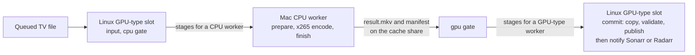

# Tdarr: HEVC encoding on the Mac Studio

The TV-library compression in [TDARR.md](TDARR.md) runs its CPU-heavy x265
encode on the Mac Studio (No-Face) instead of the homeserver. Tdarr itself
stays on the server: scanning, the queue, the UI, every integrity check and the
replacement of the file. The Studio runs a *mapped* Tdarr node that only
encodes, then hands the result back for Linux to validate and publish.

**Status (2026-11-22): production offload is active.** TV Shows, Anime TV and
Indian TV use `homeserver-hevc-offload-v2`, CRF 20 and `/temp/studio-native`,
with their schedules open. `Studio-Native` runs one CPU encoder with `pools=9`
and automatic resume enabled. Calcifer has **zero CPU encoders**, one GPU-type
publisher/DV5 worker, one CPU health-check worker and a four-CPU container quota.
Both nodes run 3.08.00; the controller image is pinned for coordinated upgrades.

A copied-file acceptance run on this actual node pair passed encoding,
publication, full decode, accented paths, module-hash verification and cache
cleanup before release. The first production episode was then observed encoding
on No-Face. Clean node restart and guarded controller recreation passed; a
mid-encode node loss, dead-tunnel recovery and cold boot were **not** exercised.
See the [acceptance record and operational follow-ups](#open-checks-before-cutover).

## Goal

- Shrink TV episodes to save server storage with minimal or no perceptual loss.
- Keep the heat and noise of sustained x265 encoding off the server. The Studio
  sits in a cooler room and has the headroom.
- Speed is not the constraint: about 13 TiB of the array is free, so a slow,
  high-quality software encode is preferred to a fast, worse one.
- Keep the Linux flow's recipe (x265 `slow`, CRF 20, the source's pixel format);
  nothing measured below justifies changing it now.

## Encoder choice: software x265

**Claim checked:** software x265 gives better quality per byte than hardware
encoders (NVENC on the server's RTX 2070 SUPER, VideoToolbox on the Studio).
**Verdict: confirmed.** "Hardware is optimized for speed" is true but
incomplete: fixed-function encoders bound their motion search and
rate-distortion optimization and lack x265's psychovisual tools, yet Turing
NVENC does support HEVC B-frames, multiple references and lookahead. How big
the gap is has to be measured, so it was.

### Measured: x265 versus VideoToolbox

Run on the Studio (M5 Max, FFmpeg 9.0.2, x265 4.3) with eight roughly
one-minute clips cut from the library: live action, animation and anime, and one
clip from a ~29 Mbps remux. Each clip was encoded with x265 `slow` at CRF 18-28
and with `hevc_videotoolbox` in quality mode (q35-q90) and average-bitrate mode
(0.7x, 1.0x, 1.4x and 2.0x the bitrate of x265 CRF 20 for that clip). VideoToolbox
used `-g 240 -bf 2` and no software fallback, because FFmpeg's defaults (a
12-frame GOP and no B-frames) handicap it and skew published comparisons. Every
encode was scored against its source with libvmaf (`vmaf_v0.6.1` and the NEG
variant), PSNR, SSIM and CAMBI on 10-bit YUV, and encoders were compared **at
equal VMAF** by interpolating between points.

| VideoToolbox setting | Extra bytes for the same VMAF as x265 `slow` | Clips |
|---|---:|---:|
| Quality mode, q65 | +41% | 6 |
| Quality mode, q80 | +48% | 4 |
| Bitrate mode, 0.7x | +101% | 8 |
| Bitrate mode, 1.0x | +77% | 8 |
| Bitrate mode, 1.4x | +74% | 8 |
| Bitrate mode, 2.0x | +87% | 6 |

Geometric means over the clips where the equal-VMAF point could be interpolated
(extrapolated points are excluded). In bitrate mode at 1.0x every one of the
eight clips needed 38% to 197% more bytes. Quality mode below q65 scored far
lower, and q90 needed 80% to 240% more bytes (extrapolated).

Averages hide the worst case. At matching average bitrate on one clip
(VideoToolbox 3,543 kbps, x265 CRF 20 3,624 kbps), VideoToolbox's
1st-percentile frame scored VMAF 90.9 and its worst frame 87.7; x265 scored 95.6
and 94.6. At 1.0x, VideoToolbox's worst frame scored 75 to 91 on every clip.
VideoToolbox is much faster (roughly 5-30x realtime against 0.3-3x for x265
`slow`; approximate, because several jobs ran at once), which is why it suits
real-time work and not a patient size-reduction queue.

### Other x265 settings (measured, not enabled)

Change in bytes at equal VMAF against `slow` at CRF 20, geometric mean over the
eight clips (four for `tune animation`):

| Variant | Bytes | Cost or caveat |
|---|---:|---|
| `medium` | +34% | |
| `slower` | -4% | roughly 3-10x the encode time |
| `slow`, 10-bit output from 8-bit sources | -10% | about 30% slower; far less banding (CAMBI); needs a client-compatibility check and a validator change (it requires the source's pixel format today) |
| `slow`, `aq-mode=3` | +9% | worse |
| `slow`, `--tune animation` | -12% | partly a VMAF artefact |

**Recommendation: keep x265 `slow` at CRF 20 in the source's pixel format**, as in
the Linux flow. 10-bit output, `slower` and `tune animation` are possible
follow-ups; none is enabled.

### Caveats

- "Perceptual" quality was measured with metrics: VMAF (including NEG), its
  1st-percentile and worst frames, and CAMBI for banding. There was no subjective
  viewing test, and VMAF is not a banding metric.
- x265's psychovisual tools (`psy-rd`, `psy-rdoq`) trade metric scores for
  subjective quality, so a VMAF comparison if anything understates x265.
- Eight clips are a small sample, and the speeds are approximate.
- Published work agrees in direction, roughly: rigaya's NVENC and x265 quality
  graphs (RTX 2070, VMAF) put NVENC's best mode at about x265 `medium`
  efficiency on live action, around a third more bytes than `veryslow`;
  Arunruangsirilert and Katto (ICCCN 2024, arXiv 2511.18686) found GPU
  encoders match software in *real-time* scenarios and gain little between GPU
  generations. NVIDIA claims its newest ultra-high-quality mode beats x265 `slow`;
  that is not shown on Turing. There is no rigorous independent VideoToolbox
  study, so the measurements above are the evidence for the Studio.

Sources: [HandBrake encoder comparison](https://handbrake.fr/docs/en/latest/technical/performance.html#performance-comparison-between-video-encoders),
[HandBrake on VideoToolbox](https://handbrake.fr/docs/en/latest/technical/video-videotoolbox.html),
[M1 Pro `hevc_videotoolbox` vs `libx265`](https://yre.jp/en/post/m1mac_h265/),
[rigaya/vq_results](https://github.com/rigaya/vq_results),
[Arunruangsirilert and Katto](https://arxiv.org/abs/2511.18686),
[x265 presets](https://x265.readthedocs.io/en/master/presets.html),
[NVENC programming guide](https://docs.nvidia.com/video-technologies/video-codec-sdk/13.0/nvenc-video-encoder-api-prog-guide/index.html).

## How it works



The flow `homeserver-hevc-offload-v2` is identical on both nodes. Whichever
worker picks up a Queued file first runs `input` and the `cpu` gate: the Linux
slot stages the file for a CPU worker, and the Mac continues. After `finish`,
the `gpu` gate does the reverse: the Mac stages the file for the Linux slot.
A staged job resumes after the last plugin that completed. The Tdarr UI shows
staged jobs as "Require CPU Worker" and "Require GPU Worker".

| Step | Runs on | What it does |
|---|---|---|
| `input` | either | Input file. |
| `cpu` | either | *Tags: Worker Type* = CPU. |
| `prepare` | Mac | Checks platform, worker type and the library's `crf` variable, then that the source is a regular file at least two minutes old on the canonical mapped path. Probes it and applies the safe-flow eligibility rules: legacy SDR video, exactly one video stream, 100 MiB to 100,000 MiB, no HDR or Dolby Vision, no data or `mov_text` streams. Anything else ends the flow as a skip. |
| `begin`, `encode`, `threads`, `container`, `execute` | Mac | Standard Tdarr FFmpeg-command plugins: `libx265`, `slow`, CRF from the library variable (20 on the TV libraries), `-x265-params pools=N`, Matroska. Non-video streams are copied. |
| `finish` | Mac | Re-checks the source is unchanged and validates the output with the safe-flow rules. An output above 95% of the source is a normal skip that keeps the original. Otherwise it moves `result.mkv` to `<cache>/offload-v1/<job>/` and writes a manifest. |
| `gpu` | either | *Tags: Worker Type* = GPU. |
| `commit` | Linux | Reads the manifest, re-probes and re-fingerprints the source, and copies the result through pinned handles into Linux-private staging. It then validates, fully decodes and publishes that private copy with the unchanged `hevc-safe-v1.cjs` logic. However it ends (published, skipped or failed) it removes its private copy and the shared handover (result and manifest). |
| `notify` | Linux | Sonarr or Radarr notification, only after a successful publication. The Mac cannot resolve `sonarr`. |

### Why the handoff uses worker types

Tdarr Pro can pin a step to a node with tags and exclude nodes per library; the
free tier ignores both (see [Free-tier limits](#free-tier-limits-and-the-2026-11-13-incident)).
The one free discriminator between the two machines is the **worker type**.
The Mac therefore has only CPU transcode workers, and Linux has only a
GPU-type transcode worker that does no GPU work for TV files: it is the
Linux-only slot that feeds jobs to the Mac and publishes the results. Linux has
no CPU transcode workers while the TV libraries use this flow. Unmapped nodes,
which upload and download files instead of sharing paths, are also Pro-only, so
the Studio is a mapped node with translated paths.

### What the Mac may and may not do

- It reads media through a **read-only** share and writes only to the cache
  share. It cannot reach Sonarr, Radarr or the Tdarr database, and runs as the
  unprivileged `_studio` user (see
  [macos/DECISIONS.md](../../macos/DECISIONS.md#isolating-untrusted-media-work)).
- Linux trusts none of the Mac's output. `commit` opens the shared cache with
  pinned `/proc/self/fd` handles and `O_NOFOLLOW`, rejects symlinks, hardlinks,
  non-regular and empty files, a file larger than the source or different from
  the manifest's recorded size, and copies the bytes into private staging (mode
  0700, outside every Mac-writable export) **before** the result is probed or
  decoded. Validation then runs only jellyfin-ffmpeg's `ffprobe` and `ffmpeg`,
  on the private copy, with `-f matroska` forced on the input, so a disguised
  playlist cannot pull in other media.
- Publication is the Linux flow's: an exclusive staging copy on the source
  filesystem and a recoverable original; an existing destination is never
  overwritten. Less than 5% saving is a normal skip, and a skip never notifies.
- The private-copy boundary stops path redirection and mutable-byte
  publication. It is **not a sandbox for malicious Tdarr plugins** and proves
  neither perceptual quality nor encoder provenance. Authenticated Tdarr API
  access, node identity and the installed plugins remain trusted.

### The DV5 flow

The Dolby Vision profile 5 flow ([TDARR-DV5.md](TDARR-DV5.md)) works only on
Linux, because its classifier needs jellyfin-ffmpeg. It therefore opens with
the same `Tags: Worker Type` GPU gate: a Mac CPU worker that fresh-selects a
movie runs only `input` and the gate, which stages the job for the Linux GPU
worker. Every movie in the DV5 library now takes a short probe in that slot.

### Checked-in implementation

- `docker/tdarr/hevc-offload-v2.cjs`: the worker module (`prepare` and `finish`
  on the Mac, `commit` on Linux). It reuses the unchanged
  `docker/tdarr/hevc-safe-v1.cjs` and, through it, `dv5-sidecar.cjs`.
- `docker/tdarr/install-offload-flow.cjs`: the flow, the disabled canary
  library and the `--adopt`, `--rollback`, `--hold` and `--release` modes;
  `docker/scripts/install-tdarr-offload.sh` deploys the modules and runs it.
- `docker/tdarr/configure-offload-nodes.cjs`: guarded node settings.
- `docker/tdarr/maintenance.cjs`: the update lease for several nodes.
- `docker/compose.studio.yml`, `nixos/modules/ssh.nix`: the SMB and Tdarr
  transport. `macos/`: the Studio side ([macos/README.md](../../macos/README.md)).

The v2 module and flow package the mapped-path handoff fix without overwriting
the older deployed v1 code or saved job snapshots. The cache and manifest
protocol remain `offload-v1`. The installer can repoint the disabled v1 canary,
but refuses to repoint an enabled canary or overwrite either version's flow.

The tests are `docker/tdarr/*.test.cjs` (`node --test`, Node 24). Run them on
Linux, inside the Tdarr container as `abc` with `TDARR_INTEGRATION_TESTS=1` to
include the FFmpeg-backed ones; four `dv5-sidecar` symlink tests fail on Windows.

## Free-tier limits and the 2026-11-13 incident

Tdarr 3.07's free tier cannot keep a node away from work:

- Per-node library exclusions (`librariesToNotProcess`) and node tags are **Pro
  features**. The API stores them, the readback succeeds and the UI shows them,
  but the free-tier scheduler ignores them. The maintainer confirms the
  requirement ([#1484](https://github.com/HaveAGitGat/Tdarr/issues/1484#issuecomment-6418340922))
  and says 3.08 reports when custom tags are ignored
  ([clarification](https://github.com/HaveAGitGat/Tdarr/issues/1484#issuecomment-6847553728)).
  Never treat a stored exclusion or tag as protection.
- Unmapped nodes need Pro as well.

On 2026-11-13 at about 13:39 UTC, a Studio node with every production library
excluded (verified in live and persisted settings) took 23 already-staged
production TV jobs. All 23 failed at once while creating the unmapped
`/temp/tdarr-workDir2-*` directory on the Mac; nothing was encoded or published,
and the originals were unchanged. After approval they were returned to Queued
at 13:59 UTC through the CRUD API, changing only `TranscodeDecisionMaker`.
Read-only inspection of the installed server explains it: queued-file selection
applies `librariesToNotProcess`, but staged-file selection does not. It checks
the worker bucket (CPU or GPU) and the required tags, and an empty tag list
always matches.

The design rules that follow:

1. **Isolation comes from flows, worker limits and library schedules**, never
   from node settings.
2. **Linux has no CPU transcode workers while any TV library uses the offload
   flow.** Any enabled library's Queued files are visible to every idle worker;
   a Linux CPU worker would pick up an offload file and run `prepare` on Linux,
   where the module deliberately throws (the file errors and needs a requeue).
3. **The Mac runs CPU transcode workers only** (no GPU transcode, no health
   checks). A library whose flow cannot run on the Mac must stop a CPU worker at
   its first step, as the DV5 flow's leading GPU gate does. Before each cutover,
   confirm no other library has `processTranscodes` enabled with a Mac-unsafe flow.
4. A library schedule with every slot unchecked stops fresh selection and,
   on the tested 3.08.00 pair, **also stops pickup of already-staged legs**.
   The three waiting canary jobs stayed idle with the Mac unpaused until the
   schedule reopened. `--hold` therefore does not guarantee a complete drain:
   an active encode can finish into a held second leg. `--adopt` and `--rollback`
   refuse staged TV rows; finish them under the existing flow with its schedule
   open, or explicitly reset only those idle rows to Queued before moving.

**Isolated end-to-end result (2026-11-22):** a copied 125 MiB H.264 sample
encoded on No-Face with the test-only CRF 24 setting, then passed the Linux
handoff, private staging, full validation and publication; the 92 MiB HEVC
result preserved audio, subtitle and duration, and an independent full decode
passed. The Tdarr job finished with `Transcode success`, and the copied source's
checksum stayed unchanged. A preceding CRF 20 attempt produced a larger file
and correctly hit the 5% savings gate. CRF 24 was only a lab setting; production
remains at CRF 20. The lab used a copied file and a test-only no-op notification,
not production media, queues or notifications. The canary also exposed and
fixed a stale work-directory path returned after the Mac moved its output.

An earlier isolated lab (2026-11-13) encoded a 475 MiB x264 episode on the Mac
in 39 minutes; the output was larger than the source (569 MiB), so Linux
validation kept the original, which is exactly what the 5% rule is for.

## Deployment contract

| Purpose | Linux (Tdarr container) | Mac Studio |
|---|---|---|
| Media, read-only to the Mac | `/data/media` | `/private/var/lib/studio-worker/mounts/media` (SMB, read-only) |
| Job cache, the only Mac-writable path | `/temp/studio-native` (host `/tmp/tdarr_transcode_cache/studio-native`) | `/private/var/lib/studio-worker/mounts/cache` (SMB, read-write) |
| Worker modules | `/app/server/Tdarr/Custom/` | `/var/lib/studio-worker/tdarr/Custom/`: `hevc-offload-v2.cjs`, `hevc-safe-v1.cjs`, `dv5-sidecar.cjs` |
| Private state | `Custom/state/offload-v1` (0700, Linux only) | none |
| FFmpeg | Tdarr's `tdarr-ffmpeg` | `/opt/homebrew/bin/ffmpeg` and `ffprobe` (checked: FFmpeg 9.0.2, x265 4.3) |
| Tdarr node socket | `tdarr:8266` | `http://127.0.0.1:8266` |

- The Studio node's path translators map the two Linux roots to the two Mac roots
  in both directions. Tdarr translates the input file, original file, work
  directory and library folder and cache per node; `args.variables` survive the
  handoffs. Staged rows store the server's (Linux) paths.
- The TV libraries' cache must be **`/temp/studio-native`**: the Mac does not
  translate `/temp`. `--adopt` sets it.
- Mapped roots must be canonical, without symlinks: use `/private/var`, not the
  macOS `/var` symlink. Symlinks below the roots are rejected too.
- Never export all of `/temp`, Tdarr's `Custom` or its state, or originals
  writable. The Linux cache root and its parent must not be replaceable by the
  SMB account.
- The Samba container (`studio-media-share` in `compose.studio.yml`) forces the
  `studio` user on the cache share, so Mac-created files appear to Linux as
  uid/gid 1000, which the Tdarr user can read and delete.
- The Studio node reaches the server through an SSH tunnel (server port 28, user
  `studio-tunnel`) to loopback-only relays for SMB (`127.0.0.1:1445`) and Tdarr
  (`127.0.0.1:8266`); the SSH `Match` block permits only those two destinations.
  The node uses a dedicated Tdarr API key: SSH protects the LAN hop, not
  application authorization. `https://tdarr.danteb.com` serves the web UI on
  8265, not the node socket; pointing the node there returns `Invalid namespace`.
- The node runs under `nice -n 10`, with one CPU transcode worker, no GPU or
  health-check workers, and starts paused by default (`macos/start-tdarr.sh`).
  After cutover, `install-tdarr-node.sh --auto-resume --start` persists automatic
  resume across node restarts and installer updates. `--start-paused` reverses
  that choice; it does not change the controller's current pause state.
- The controller image is pinned to the deployed 3.08.00 digest, matching the
  native node. Upgrade both together; the daily image pull must not silently
  advance the controller beyond the Mac's installed version.

## Operations

### Installing and moving libraries

From the server, after the commits are deployed (every mode previews until
`--apply`; the module copy is idempotent and always happens):

```bash
bash /srv/homeserver/docker/scripts/install-tdarr-offload.sh            # preview
bash /srv/homeserver/docker/scripts/install-tdarr-offload.sh --apply    # flow + disabled canary
```

| Option | Effect |
|---|---|
| none | Installs the offload flow and the **disabled** canary library `homeserver-hevc-studio-canary-v1` (folder `/data/media/tdarr-studio-canary`). |
| `--adopt` | Moves TV Shows, Anime TV and Indian TV onto the offload flow and `/temp/studio-native`. |
| `--rollback` | Moves them back to `homeserver-hevc-cpu-v1` and `/temp`. |
| `--hold` | Unchecks every schedule slot of the TV libraries so nothing new starts; running jobs finish. |
| `--release` | Checks every slot again, once the nodes match the flow the libraries use. |
| `--pools N` | x265 thread pools per encode, 1-64 (default 9). Only with no mode or `--adopt`. |
| `--mac-node NAME` | The Studio node's name (default `Studio-Native`). |

The three TV libraries are one group. `--hold` and `--release` only toggle an
all-checked or all-unchecked schedule (a partial one is refused), and `--release`
reopens every closed library, including one you had closed on purpose: close that
one again afterwards.

The installer saves the previous flows, libraries and CRF variables (plus the
saved node settings for `--adopt`, `--rollback` and `--release`) to a sensitive
`Custom/backups/offload-flow-*.json` (mode 0600, in a 0700 directory; its path is
the `Backup (sensitive):` line), reads back each write and never deletes the old
flows, so running jobs keep their snapshot. It does not change worker limits, and
it touches the Studio node only in the one case described below (a rollback while
the Studio is offline). Just before writing it reads everything again and plans
again, and writes nothing if the plan differs. If a write then fails part-way, the
error says how many changes were applied and which were not, and running the same
command again finishes the rest. Its errors never print flow contents, because
flows embed the Sonarr API key. A library moves only while quiescent
(processing off, or no schedule slot checked), with exactly one `crf` variable
(`--adopt` also needs it to be a number from 0 to 51) and no staged rows:
`--adopt` and `--rollback` refuse while any TV file is staged (a running job
counts), so let those finish or reset them first. These library checks run before
the node checks, so a
preview taken right after `--hold` that complains only about the nodes means the
libraries are ready. When there is something to change, the previews that install
modules (no mode, `--adopt`) also check that the deployed module files and the
cache root exist.

The nodes must also match, or `--adopt` and the matching `--release` refuse:
the Studio connected with at least one CPU transcode worker and none of the GPU
type or health-check types (it may be paused); every other node at zero CPU
transcode workers, with `allowGpuDoCpu` off and no CPU encode running (a node
that is offline is judged by its saved settings, because it comes back with them,
so one that still allows CPU encodes blocks the move until it is reconnected and
set to zero or removed in Tdarr); and at least one **unpaused** other
node with a GPU transcode worker, because the Linux leg publishes what the Mac
encodes. `--rollback` and its `--release` need an unpaused non-Studio node with
CPU transcode workers, and a connected Studio must be paused or at zero CPU
workers with no CPU encode running. If the Studio is offline, `--rollback` cannot
pause it through the API, so its first change is to set `nodePaused` in the
Studio's saved settings, and `--release` refuses ("run --rollback --apply first")
until that is done. Whether Tdarr applies that saved state or the start script's
`startPaused` after a re-registration is not a safe rollback boundary, especially
with opt-in auto-resume. Stop and disable the Mac daemon before releasing
Linux-only schedules. The rollback
sequence legitimately raises Linux CPU workers while the libraries are still on
the offload flow; only the schedule gate protects that window, so run `--hold`
first.

### Node settings

```bash
docker exec --user abc tdarr node /app/server/Tdarr/Custom/configure-offload-nodes.cjs \
  --node-name Studio-Native --set transcodecpu=1 --resume            # preview
docker exec --user abc tdarr node /app/server/Tdarr/Custom/configure-offload-nodes.cjs \
  --node-name Studio-Native --set transcodecpu=1 --resume --apply
```

Types are `healthcheckcpu`, `healthcheckgpu`, `transcodecpu` and `transcodegpu`
(0-32 each); `--pause` and `--resume` change the pause state; the node must be
connected. It never lowers a limit under a busy worker, refuses an empty request
and sends the full limits object. Because no node setting can keep a worker away
from a library without Tdarr Pro, it also enforces the design's invariants:

- The Studio takes CPU encodes only: it refuses to set a non-zero GPU or
  health-check limit even while paused, and an active Studio must have them at 0.
- The Studio becomes active (a CPU limit of 1 or more, unpaused) only while all
  three TV libraries use the offload flow or are quiescent, and an unpaused Linux
  node has a GPU worker to publish its encodes.
- A Linux node cannot start or enlarge CPU encoding while a library on the
  offload flow can still start jobs, because the flow's Mac steps throw on Linux.
  Run `--hold` first, or keep that node paused or at zero.
- A Linux node cannot be paused, or have its GPU limit zeroed, while it is the
  only unpaused node with a GPU worker, unless the Studio is paused (or at zero)
  with no encode running and, once any library uses the offload flow, no job of
  that flow is staged. A finished Mac leg waiting for the Linux GPU worker is
  invisible to `get-nodes` (it lists busy workers only), so the configurator also
  reads the staging table; a staged row that names no library counts.

Applying writes a sensitive `Custom/backups/offload-node-*.json` (mode 0600),
re-checks for races, then reads back the live and persisted settings.

The Studio side (launcher, privacy grant, mounts, tunnel and the installer
`macos/install/install-tdarr-node.sh [--modules DIR] [--start|--stop] [--auto-resume|--start-paused] [--replace-launcher]`)
is in [macos/README.md](../../macos/README.md). Never rebuild or replace the
launcher: macOS ties its one-time Full Disk Access grant to its path and code
hash, so the installer builds it only when it is missing.

### Updates

The update guard pauses every connected node under one lease and restores each to
its own prior state; see [Updates and active jobs](TDARR.md#updates-and-active-jobs).
It defers while any worker is busy and also while any job is staged (a leg
waiting for its next worker); an unreadable staging database fails closed, so
the container is kept running. Held schedules also block staged pickup: a
hold or node pause alone does not empty staging.
Both nodes run 3.08.00. The server image is pinned to
`ghcr.io/haveagitgat/tdarr@sha256:84743e5ae433a5b49cb463b2dff2679eb02f0cac24fb88c830f49bf8aa9f1c04`.
Upgrade the native node and controller together, with no busy or staged jobs;
the maintenance guard does not itself verify version compatibility.

### Failed or abandoned jobs

The Linux leg always purges its job's shared handover (the Mac's result and
manifest) and its private staging when it ends, whether the job published,
skipped for lack of savings or failed. Cleanup problems are logged without
misreporting a completed publication. A failed commit therefore leaves nothing to
inspect in the cache: the reason is in the Tdarr job log, and the original is
untouched or restored. Only if the original changed during publication does the
safe module keep it as a `.partial.old` file beside the library file (the job log
names it) for manual recovery.

No lock is needed to retry or to survive a replay: every commit re-probes the
source, checks it against the manifest and the Mac's fingerprint, renames the
original aside and publishes with an exclusive hard link, so a second or parallel
commit fails or finds the file already replaced and changes nothing. Requeue a
failed file and the Mac encodes it again. A best-effort sweep at each commit
removes abandoned handovers (killed jobs, reset queue rows) after 7 days and
abandoned private staging after 24 hours; monitor cache capacity and private-state
retention.

### When the Studio is offline

Tdarr drops a node that disappears: `get-nodes` stops listing it and the server
log records `Node Studio-Native deregistered`. With Linux at zero CPU transcode
workers, TV encoding simply waits for the Studio, and the Studio's other
services (Whisper for Bazarr, Ollama) fail safe. To resume encoding on Linux
instead, follow the rollback below. FileVault is on, so after a power loss the
Studio does not restart services until its disk is unlocked
([details](../../macos/DECISIONS.md#headless-and-back-on-its-own-after-power-loss)).

## Cutover and rollback

Preconditions: matching worker modules and a successful copied-file acceptance
run; the Studio connected with a CPU limit of at least 1; every enabled library
re-listed for Mac-safe entry gates (rule 3 above); each TV library has exactly
one valid `crf` variable. Keep the Studio paused or the TV schedules held while
changing routing. Review the [acceptance record](#open-checks-before-cutover).
Snapshot the libraries, flows, variables and node settings first (the installer
and configurator write backups under `Custom/backups`). Run each command without
`--apply` first. Preview `--adopt` (or `--rollback`) right after `--hold` and
before touching any worker limit: it reports library problems (a library still
processing, a bad `crf` variable, a staged TV job, which includes a running one)
before node problems, so once its only complaint is about the nodes, the libraries
are ready.

**Cutover** (from `/srv/homeserver/docker` on the server):

```bash
bash scripts/install-tdarr-offload.sh --hold --apply
bash scripts/install-tdarr-offload.sh --adopt --pools 9    # preview, until only the nodes are in the way
# wait until no Linux transcodecpu worker is busy
docker exec --user abc tdarr node /app/server/Tdarr/Custom/configure-offload-nodes.cjs \
  --node-name HomeServer --set transcodecpu=0 --apply
bash scripts/install-tdarr-offload.sh --adopt --pools 9 --apply
# set transcodecpuWorkers: "0" for tdarr in compose.starr.yml; deploy via the guarded update
docker exec --user abc tdarr node /app/server/Tdarr/Custom/configure-offload-nodes.cjs \
  --node-name Studio-Native --set transcodecpu=1 --resume --apply
bash scripts/install-tdarr-offload.sh --release --apply
```

The Studio is resumed while the libraries are still held, because the schedule
gate stops its fresh selection as well; `--release` then lets work flow. Afterwards
check the schedules: `--release` reopens all three TV libraries, including one you
had closed on purpose. Watch the first jobs end to end: the job report,
publication in the library folder, the Sonarr notification, the cache directory
emptying, and the server's CPU load. New installations start paused. Dante
selected automatic resume after the production cutover: install with
`--auto-resume --start` once the acceptance jobs succeed. The worker-owned
`tdarr-start-paused` file then contains `false`; ordinary installer updates
preserve it. FileVault still requires unlocking after a full power loss.

**Rollback:**

1. `--hold --apply`, then wait until no TV worker is running. Held schedules
   also block staged handoffs: if any TV rows remain staged, do not assume they
   will drain. Finish them under the existing topology with schedules open, or
   reset only the idle staged TV rows to Queued in Tdarr (discarding that
   attempt's encode). The `--rollback` preview must report no staged TV rows.
2. Pause the Studio node (`--pause`). If auto-resume was enabled, stop and
   disable its daemon with `install-tdarr-node.sh --stop` before restoring
   HomeServer CPU workers; a Mac node restart must not resume into Linux-only
   flows. Raise HomeServer `transcodecpu` back to 4.
3. `--rollback --apply`, then revert the compose `transcodecpuWorkers` value.
4. `--release --apply` (refused unless Linux can encode and the Studio is paused
   or at zero), and stop the Studio node with `install-tdarr-node.sh --stop` if
   it is not needed (it unloads and disables the daemon, then waits up to a
   minute for the node, its encoders and any share probe to exit; it exits 3 and
   lists whatever is left). Check the schedules afterwards.

If the Studio is offline when you roll back, `--rollback` pauses its saved
settings, and `--release` refuses until that has happened. This does not disable
its auto-resuming daemon. If auto-resume is enabled, keep schedules held, bring
the Mac back, and stop/disable its daemon before releasing Linux-only work.

If a step fails or is interrupted part-way, do not release. The installer's error
lists what was applied and what was not; run the same command again to finish.
Otherwise restore the previous worker limits and pause states with the
configurator (its backups hold them) and run `--release` only when the nodes
match the flow the libraries use; it refuses otherwise.

<a id="open-checks-before-cutover"></a>

## Acceptance record and operational follow-ups

Verified during the 2026-11-22 cutover; copied-media acceptance passed before
opening the production TV schedules:

| Check | Result |
|---|---|
| Production node pair, copied media | A 125 MiB H.264 copy with an accented filename became 96,755,901 bytes of HEVC, with AAC/SubRip and duration 332.559 s preserved. Linux publication and an independent full decode passed. CRF 24 was test-only; all production TV variables remain 20. |
| Stream eligibility and saving skips | Tiny valid copies became `Not required`; the earlier isolated CRF 20 oversized result also skipped safely. |
| More staged files than CPU workers | Three original staging instances, checked by their unchanged start times, survived 372-376 seconds with only one Mac CPU worker. They resumed without being discarded. |
| Production staging | The queue reached the configured `stagedFileLimit=100`: one Mac encode and 99 waiting CPU legs. Repeated snapshots stayed at 100; sampled original waiting starts survived over ten minutes without re-staging. |
| Schedule hold | The unpaused Mac did not resume held staged rows; reopening only the canary schedule started encoding. A hold is not a complete drain. |
| Modules and SMB handoff | Mac UID 499 and the server both used v2 SHA-256 `ac44184bf5d3a9db03a4c14b2db1d9229a1280e6053d4ae6901324c7277a4bee`. The manifest was 0600 with one link; canonical translated paths, shared renames and Linux-private copy/publication passed. |
| Cleanup | The successful shared handover disappeared. The three disposable acceptance files were removed after disabling their test library. |
| Real Mac installer | Install, stop with no remaining node/encoder, restart, unchanged launcher CDHash/FDA and automatic unpaused registration passed. The encode had finished before the stop, so this was **not** a mid-encode interruption test. |
| Persistent limits | The Mac launch seed changed its saved CPU limit from two to one. Calcifer re-registered at zero CPU encoders and one health worker after recreation, with its four-CPU quota applied. |
| Controller maintenance | Two idle prepare/recreate/release round trips restored both connected nodes within the guard's retry window, including the Mac's unpaused state. |
| Version compatibility | Both are 3.08.00. The controller is pinned to the tested image digest; upgrade the native node and controller together. |

Remaining operational checks, not claimed as tested by this rollout:

- Mid-encode node loss, dead SSH/SMB transport and recovery of orphaned cache
  directories. The Mac remains read-only on originals and Linux still refuses
  invalid or incomplete handovers; do not bypass those checks to recover a job.
- Cold boot and FileVault unlocking. Automatic resume was verified for a node
  restart, not a power loss.
- Sustained thermal/noise tuning beyond the conservative one-worker,
  nine-thread-pool setting. No-Face reported no thermal/performance warning
  during the observed run; this is not a long-duration thermal benchmark.
- A new DV5 canary on this two-node deployment. Its existing leading GPU gate
  and exactly one Linux GPU worker are retained; a second GPU worker remains
  unsupported by this runbook.
- Deliberately offsetting SMB modification time by one second, the long-term
  cache cleaner after a lost job, and an observed hourly plugin-sync cycle.
  Normal SMB timestamps, publication and cleanup passed.

Never lower a busy worker's limit: the configurator deliberately refuses it.
No destructive test of that upstream behavior is needed for routine operation.

<a id="studio-script-mocked-tests-live-checks"></a>

### Studio script mocked tests and live checks

The installer (`macos/install/install-tdarr-node.sh`) and the dead-mount handling
in `macos/start-tdarr.sh` were rewritten while the Studio was unreachable. Their
41 regression tests ran on No-Face on 2026-11-22, exercising the real scripts
against stubs and temporary directories. The tests do not invoke system
`launchd`, install files in production locations, or change Full Disk Access.
The real installer subsequently installed and started the production node,
retained the launcher's CDHash and Full Disk Access grant, and mounted read-only
media and writable cache as `_studio`. A clean `--stop` reported no remaining
node, encoder or probe, and `--auto-resume --start` re-registered unpaused.

Still untested against a deliberately broken live transport:

- `bounded` reaching its timeout under macOS perl and terminating its process
  group rather than leaving a stuck SMB probe.
- A dead mount (stop the SSH tunnel): the probes return within their limits,
  `umount -f` as `_studio` works, and the watchdog stops the node so that launchd
  restarts it and it remounts. Also whether the `smbfs` mounts are hard or soft,
  since that decides what a dead tunnel does to an encode in flight.
