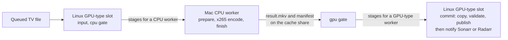

# Tdarr: HEVC encoding on the Mac Studio

The TV-library compression in [TDARR.md](TDARR.md) can run its CPU-heavy x265
encode on the Mac Studio (`ai-studio`) instead of the homeserver. Tdarr itself
stays on the server: scanning, the queue, the UI, every integrity check and the
replacement of the file. The Studio runs a *mapped* Tdarr node that only
encodes, then hands the result back for Linux to validate and publish.

**Status (2026-11-14): built, unit-tested and deployed, not activated.** The
flow definition, installers and node tooling are on the server, and the Studio
node is installed and starts paused, but the offload flow is not installed in
Tdarr yet. The three TV libraries still use the Linux-only
`homeserver-hevc-cpu-v1` flow. Production moves only after the
[open checks](#open-checks-before-cutover) pass; update this paragraph then.

## Goal

- Shrink TV episodes to save server storage with minimal or no perceptual loss.
- Keep the heat and noise of sustained x265 encoding off the server. The Studio
  sits in a cooler room and has the headroom.
- Speed is not the constraint: about 13 TiB of the array is free, so a slow,
  high-quality software encode is preferred to a fast, worse one.
- Keep the Linux flow's recipe (x265 `slow`, CRF 20, the source's pixel format);
  nothing measured below justifies changing it now.

## Encoder choice: software x265

**Claim checked:** software x265 gives better quality per byte than hardware
encoders (NVENC on the server's RTX 2070 SUPER, VideoToolbox on the Studio).
**Verdict: confirmed.** "Hardware is optimized for speed" is true but
incomplete: fixed-function encoders bound their motion search and
rate-distortion optimization and lack x265's psychovisual tools, yet Turing
NVENC does support HEVC B-frames, multiple references and lookahead. How big
the gap is has to be measured, so it was.

### Measured: x265 versus VideoToolbox

Run on the Studio (M5 Max, FFmpeg 9.0.2, x265 4.3) with eight roughly
one-minute clips cut from the library: live action, animation and anime, and one
clip from a ~29 Mbps remux. Each clip was encoded with x265 `slow` at CRF 18-28
and with `hevc_videotoolbox` in quality mode (q35-q90) and average-bitrate mode
(0.7x, 1.0x, 1.4x and 2.0x the bitrate of x265 CRF 20 for that clip). VideoToolbox
used `-g 240 -bf 2` and no software fallback, because FFmpeg's defaults (a
12-frame GOP and no B-frames) handicap it and skew published comparisons. Every
encode was scored against its source with libvmaf (`vmaf_v0.6.1` and the NEG
variant), PSNR, SSIM and CAMBI on 10-bit YUV, and encoders were compared **at
equal VMAF** by interpolating between points.

| VideoToolbox setting | Extra bytes for the same VMAF as x265 `slow` | Clips |
|---|---:|---:|
| Quality mode, q65 | +41% | 6 |
| Quality mode, q80 | +48% | 4 |
| Bitrate mode, 0.7x | +101% | 8 |
| Bitrate mode, 1.0x | +77% | 8 |
| Bitrate mode, 1.4x | +74% | 8 |
| Bitrate mode, 2.0x | +87% | 6 |

Geometric means over the clips where the equal-VMAF point could be interpolated
(extrapolated points are excluded). In bitrate mode at 1.0x every one of the
eight clips needed 38% to 197% more bytes. Quality mode below q65 scored far
lower, and q90 needed 80% to 240% more bytes (extrapolated).

Averages hide the worst case. At matching average bitrate on one clip
(VideoToolbox 3,543 kbps, x265 CRF 20 3,624 kbps), VideoToolbox's
1st-percentile frame scored VMAF 90.9 and its worst frame 87.7; x265 scored 95.6
and 94.6. At 1.0x, VideoToolbox's worst frame scored 75 to 91 on every clip.
VideoToolbox is much faster (roughly 5-30x realtime against 0.3-3x for x265
`slow`; approximate, because several jobs ran at once), which is why it suits
real-time work and not a patient size-reduction queue.

### Other x265 settings (measured, not enabled)

Change in bytes at equal VMAF against `slow` at CRF 20, geometric mean over the
eight clips (four for `tune animation`):

| Variant | Bytes | Cost or caveat |
|---|---:|---|
| `medium` | +34% | |
| `slower` | -4% | roughly 3-10x the encode time |
| `slow`, 10-bit output from 8-bit sources | -10% | about 30% slower; far less banding (CAMBI); needs a client-compatibility check and a validator change (it requires the source's pixel format today) |
| `slow`, `aq-mode=3` | +9% | worse |
| `slow`, `--tune animation` | -12% | partly a VMAF artefact |

**Recommendation: keep x265 `slow` at CRF 20 in the source's pixel format**, as in
the Linux flow. 10-bit output, `slower` and `tune animation` are possible
follow-ups; none is enabled.

### Caveats

- "Perceptual" quality was measured with metrics: VMAF (including NEG), its
  1st-percentile and worst frames, and CAMBI for banding. There was no subjective
  viewing test, and VMAF is not a banding metric.
- x265's psychovisual tools (`psy-rd`, `psy-rdoq`) trade metric scores for
  subjective quality, so a VMAF comparison if anything understates x265.
- Eight clips are a small sample, and the speeds are approximate.
- Published work agrees in direction, roughly: rigaya's NVENC and x265 quality
  graphs (RTX 2070, VMAF) put NVENC's best mode at about x265 `medium`
  efficiency on live action, around a third more bytes than `veryslow`;
  Arunruangsirilert and Katto (ICCCN 2024, arXiv 2511.18686) found GPU
  encoders match software in *real-time* scenarios and gain little between GPU
  generations. NVIDIA claims its newest ultra-high-quality mode beats x265 `slow`;
  that is not shown on Turing. There is no rigorous independent VideoToolbox
  study, so the measurements above are the evidence for the Studio.

Sources: [HandBrake encoder comparison](https://handbrake.fr/docs/en/latest/technical/performance.html#performance-comparison-between-video-encoders),
[HandBrake on VideoToolbox](https://handbrake.fr/docs/en/latest/technical/video-videotoolbox.html),
[M1 Pro `hevc_videotoolbox` vs `libx265`](https://yre.jp/en/post/m1mac_h265/),
[rigaya/vq_results](https://github.com/rigaya/vq_results),
[Arunruangsirilert and Katto](https://arxiv.org/abs/2511.18686),
[x265 presets](https://x265.readthedocs.io/en/master/presets.html),
[NVENC programming guide](https://docs.nvidia.com/video-technologies/video-codec-sdk/13.0/nvenc-video-encoder-api-prog-guide/index.html).

## How it works



The flow `homeserver-hevc-offload-v1` is identical on both nodes. Whichever
worker picks up a Queued file first runs `input` and the `cpu` gate: the Linux
slot stages the file for a CPU worker, and the Mac continues. After `finish`,
the `gpu` gate does the reverse: the Mac stages the file for the Linux slot.
A staged job resumes after the last plugin that completed. The Tdarr UI shows
staged jobs as "Require CPU Worker" and "Require GPU Worker".

| Step | Runs on | What it does |
|---|---|---|
| `input` | either | Input file. |
| `cpu` | either | *Tags: Worker Type* = CPU. |
| `prepare` | Mac | Checks platform, worker type and the library's `crf` variable, then that the source is a regular file at least two minutes old on the canonical mapped path. Probes it and applies the safe-flow eligibility rules: legacy SDR video, exactly one video stream, 100 MiB to 100,000 MiB, no HDR or Dolby Vision, no data or `mov_text` streams. Anything else ends the flow as a skip. |
| `begin`, `encode`, `threads`, `container`, `execute` | Mac | Standard Tdarr FFmpeg-command plugins: `libx265`, `slow`, CRF from the library variable (20 on the TV libraries), `-x265-params pools=N`, Matroska. Non-video streams are copied. |
| `finish` | Mac | Re-checks the source is unchanged and validates the output with the safe-flow rules. An output above 95% of the source is a normal skip that keeps the original. Otherwise it moves `result.mkv` to `<cache>/offload-v1/<job>/` and writes a manifest. |
| `gpu` | either | *Tags: Worker Type* = GPU. |
| `commit` | Linux | Reads the manifest, re-probes and re-fingerprints the source, and copies the result through pinned handles into Linux-private staging. It then validates, fully decodes and publishes that private copy with the unchanged `hevc-safe-v1.cjs` logic and, on success, removes the shared result. |
| `notify` | Linux | Sonarr or Radarr notification, only after a successful publication. The Mac cannot resolve `sonarr`. |

### Why the handoff uses worker types

Tdarr Pro can pin a step to a node with tags and exclude nodes per library; the
free tier ignores both (see [Free-tier limits](#free-tier-limits-and-the-2026-11-13-incident)).
The one free discriminator between the two machines is the **worker type**.
The Mac therefore has only CPU transcode workers, and Linux has only a
GPU-type transcode worker that does no GPU work for TV files: it is the
Linux-only slot that feeds jobs to the Mac and publishes the results. Linux has
no CPU transcode workers while the TV libraries use this flow. Unmapped nodes,
which upload and download files instead of sharing paths, are also Pro-only, so
the Studio is a mapped node with translated paths.

### What the Mac may and may not do

- It reads media through a **read-only** share and writes only to the cache
  share. It cannot reach Sonarr, Radarr or the Tdarr database, and runs as the
  unprivileged `_studio` user (see
  [macos/DECISIONS.md](../../macos/DECISIONS.md#isolating-untrusted-media-work)).
- Linux trusts none of the Mac's output. `commit` opens the shared cache with
  pinned `/proc/self/fd` handles and `O_NOFOLLOW`, rejects symlinks, hardlinks,
  non-regular and empty files, a file larger than the source or different from
  the manifest's recorded size, and copies the bytes into private staging (mode
  0700, outside every Mac-writable export) **before** the result is probed or
  decoded. Validation then runs only jellyfin-ffmpeg's `ffprobe` and `ffmpeg`,
  on the private copy, with `-f matroska` forced on the input, so a disguised
  playlist cannot pull in other media.
- Publication is the Linux flow's: an exclusive staging copy on the source
  filesystem and a recoverable original; an existing destination is never
  overwritten. Less than 5% saving is a normal skip, and a skip never notifies.
- The private-copy boundary stops path redirection and mutable-byte
  publication. It is **not a sandbox for malicious Tdarr plugins** and proves
  neither perceptual quality nor encoder provenance. Authenticated Tdarr API
  access, node identity and the installed plugins remain trusted.

### The DV5 flow

The Dolby Vision profile 5 flow ([TDARR-DV5.md](TDARR-DV5.md)) works only on
Linux, because its classifier needs jellyfin-ffmpeg. It therefore opens with
the same `Tags: Worker Type` GPU gate: a Mac CPU worker that fresh-selects a
movie runs only `input` and the gate, which stages the job for the Linux GPU
worker. Every movie in the DV5 library now takes a short probe in that slot.

### Checked-in implementation

- `docker/tdarr/hevc-offload-v1.cjs`: the worker module (`prepare` and `finish`
  on the Mac, `commit` on Linux). It reuses the unchanged
  `docker/tdarr/hevc-safe-v1.cjs` and, through it, `dv5-sidecar.cjs`.
- `docker/tdarr/install-offload-flow.cjs`: the flow, the disabled canary
  library and the `--adopt`, `--rollback`, `--hold` and `--release` modes;
  `docker/scripts/install-tdarr-offload.sh` deploys the modules and runs it.
- `docker/tdarr/configure-offload-nodes.cjs`: guarded node settings.
- `docker/tdarr/maintenance.cjs`: the update lease for several nodes.
- `docker/compose.studio.yml`, `nixos/modules/ssh.nix`: the SMB and Tdarr
  transport. `macos/`: the Studio side ([macos/README.md](../../macos/README.md)).

The tests are `docker/tdarr/*.test.cjs` (`node --test`, Node 24). Run them on
Linux, inside the Tdarr container as `abc` with `TDARR_INTEGRATION_TESTS=1` to
include the FFmpeg-backed ones; four `dv5-sidecar` symlink tests fail on Windows.

## Free-tier limits and the 2026-11-13 incident

Tdarr 3.07's free tier cannot keep a node away from work:

- Per-node library exclusions (`librariesToNotProcess`) and node tags are **Pro
  features**. The API stores them, the readback succeeds and the UI shows them,
  but the free-tier scheduler ignores them. The maintainer confirms the
  requirement ([#1484](https://github.com/HaveAGitGat/Tdarr/issues/1484#issuecomment-6418340922))
  and says 3.08 reports when custom tags are ignored
  ([clarification](https://github.com/HaveAGitGat/Tdarr/issues/1484#issuecomment-6847553728)).
  Never treat a stored exclusion or tag as protection.
- Unmapped nodes need Pro as well.

On 2026-11-13 at about 13:39 UTC, a Studio node with every production library
excluded (verified in live and persisted settings) took 23 already-staged
production TV jobs. All 23 failed at once while creating the unmapped
`/temp/tdarr-workDir2-*` directory on the Mac; nothing was encoded or published,
and the originals were unchanged. After approval they were returned to Queued
at 13:59 UTC through the CRUD API, changing only `TranscodeDecisionMaker`.
Read-only inspection of the installed server explains it: queued-file selection
applies `librariesToNotProcess`, but staged-file selection does not. It checks
the worker bucket (CPU or GPU) and the required tags, and an empty tag list
always matches.

The design rules that follow:

1. **Isolation comes from flows, worker limits and library schedules**, never
   from node settings.
2. **Linux has no CPU transcode workers while any TV library uses the offload
   flow.** Any enabled library's Queued files are visible to every idle worker;
   a Linux CPU worker would pick up an offload file and run `prepare` on Linux,
   where the module deliberately throws (the file errors and needs a requeue).
3. **The Mac runs CPU transcode workers only** (no GPU transcode, no health
   checks). A library whose flow cannot run on the Mac must stop a CPU worker at
   its first step, as the DV5 flow's leading GPU gate does. Before each cutover,
   confirm no other library has `processTranscodes` enabled with a Mac-unsafe flow.
4. A library schedule with every slot unchecked stops fresh selection of that
   library's Queued files without aborting running jobs (observed), and new
   files are still scanned and queued. `--hold` and `--release` use it. Whether
   it also stops the pickup of already-staged jobs is unverified, which is why
   `--adopt` refuses to move a library that has staged rows.

Lab results: an isolated canary of this design passed a Mac encode and the
Linux handoff, and a staged job was picked up about 13 seconds after staging.
An earlier isolated lab (2026-11-13) encoded a 475 MiB x264 episode on the Mac
in 39 minutes; the output was larger than the source (569 MiB), so Linux
validation kept the original, which is exactly what the 5% rule is for.

## Deployment contract

| Purpose | Linux (Tdarr container) | Mac Studio |
|---|---|---|
| Media, read-only to the Mac | `/data/media` | `/private/var/lib/studio-worker/mounts/media` (SMB, read-only) |
| Job cache, the only Mac-writable path | `/temp/studio-native` (host `/tmp/tdarr_transcode_cache/studio-native`) | `/private/var/lib/studio-worker/mounts/cache` (SMB, read-write) |
| Worker modules | `/app/server/Tdarr/Custom/` | `/var/lib/studio-worker/tdarr/Custom/`: `hevc-offload-v1.cjs`, `hevc-safe-v1.cjs`, `dv5-sidecar.cjs` |
| Private state | `Custom/state/offload-v1` (0700, Linux only) | none |
| FFmpeg | Tdarr's `tdarr-ffmpeg` | `/opt/homebrew/bin/ffmpeg` and `ffprobe` (checked: FFmpeg 9.0.2, x265 4.3) |
| Tdarr node socket | `tdarr:8266` | `http://127.0.0.1:8266` |

- The Studio node's path translators map the two Linux roots to the two Mac roots
  in both directions. Tdarr translates the input file, original file, work
  directory and library folder and cache per node; `args.variables` survive the
  handoffs. Staged rows store the server's (Linux) paths.
- The TV libraries' cache must be **`/temp/studio-native`**: the Mac does not
  translate `/temp`. `--adopt` sets it.
- Mapped roots must be canonical, without symlinks: use `/private/var`, not the
  macOS `/var` symlink. Symlinks below the roots are rejected too.
- Never export all of `/temp`, Tdarr's `Custom` or its state, or originals
  writable. The Linux cache root and its parent must not be replaceable by the
  SMB account.
- The Samba container (`studio-media-share` in `compose.studio.yml`) forces the
  `studio` user on the cache share, so Mac-created files appear to Linux as
  uid/gid 1000, which the Tdarr user can read and delete.
- The Studio node reaches the server through an SSH tunnel (server port 28, user
  `studio-tunnel`) to loopback-only relays for SMB (`127.0.0.1:1445`) and Tdarr
  (`127.0.0.1:8266`); the SSH `Match` block permits only those two destinations.
  The node uses a dedicated Tdarr API key: SSH protects the LAN hop, not
  application authorization. `https://tdarr.danteb.com` serves the web UI on
  8265, not the node socket; pointing the node there returns `Invalid namespace`.
- The node runs under `nice -n 10`, with one CPU transcode worker, no GPU or
  health-check workers, and starts paused (`macos/start-tdarr.sh`).

## Operations

### Installing and moving libraries

From the server, after the commits are deployed (every mode previews until
`--apply`; the module copy is idempotent and always happens):

```bash
bash /srv/homeserver/docker/scripts/install-tdarr-offload.sh            # preview
bash /srv/homeserver/docker/scripts/install-tdarr-offload.sh --apply    # flow + disabled canary
```

| Option | Effect |
|---|---|
| none | Installs the offload flow and the **disabled** canary library `homeserver-hevc-studio-canary-v1` (folder `/data/media/tdarr-studio-canary`). |
| `--adopt` | Moves TV Shows, Anime TV and Indian TV onto the offload flow and `/temp/studio-native`. |
| `--rollback` | Moves them back to `homeserver-hevc-cpu-v1` and `/temp`. |
| `--hold` | Unchecks every schedule slot of the TV libraries so nothing new starts; running jobs finish. |
| `--release` | Checks the slots again, once the nodes match the flow the libraries use. |
| `--pools N` | x265 thread pools per encode, 1-64 (default 9). Only with no mode or `--adopt`. |
| `--mac-node NAME` | The Studio node's name (default `Studio-Native`). |

The installer saves the previous flows, libraries and CRF variables to a
sensitive `Custom/backups/offload-flow-*.json` (mode 0600), reads back each write
and never deletes the old flows, so running jobs keep their snapshot. It does not
change worker limits or the Studio node. A library moves only while quiescent
(processing off, or no schedule slot checked), with exactly one `crf` variable and
no staged rows.

The nodes must also match, or `--adopt` and the matching `--release` refuse:
the Studio connected once with at least one CPU transcode worker and none of the
GPU type (it may be paused); every other node at zero CPU transcode workers, with
`allowGpuDoCpu` off and nothing busy; and at least one other node with a GPU
transcode worker. `--rollback` needs a non-Studio node with CPU transcode
workers, and a connected Studio must be paused or at zero CPU workers and idle.
The rollback sequence legitimately raises Linux CPU workers while the libraries
are still on the offload flow; only the schedule gate protects that window, so
run `--hold` first.

### Node settings

```bash
docker exec --user abc tdarr node /app/server/Tdarr/Custom/configure-offload-nodes.cjs \
  --node-name Studio-Native --set transcodecpu=2 --resume            # preview
docker exec --user abc tdarr node /app/server/Tdarr/Custom/configure-offload-nodes.cjs \
  --node-name Studio-Native --set transcodecpu=2 --resume --apply
```

Types are `healthcheckcpu`, `healthcheckgpu`, `transcodecpu` and `transcodegpu`
(0-32 each); `--pause` and `--resume` change the pause state; the node must be
connected. It never lowers a limit under a busy worker, refuses an empty request
and sends the full limits object. On the Studio it refuses any non-zero GPU or
health-check limit even while paused, and a non-zero CPU limit while the node is
active unless all three TV libraries use the offload flow or are quiescent.
Applying writes a sensitive `Custom/backups/offload-node-*.json` (mode 0600),
re-checks for races, then reads back the live and persisted settings.

The Studio side (launcher, privacy grant, mounts, tunnel and the installer
`macos/install/install-tdarr-node.sh [--modules DIR] [--start|--stop]`) is in
[macos/README.md](../../macos/README.md). Never rebuild or replace the launcher:
macOS ties its one-time Full Disk Access grant to its path and code hash.

### Updates

The update guard pauses every connected node under one lease and restores each to
its own prior state; see [Updates and active jobs](TDARR.md#updates-and-active-jobs).
The Studio node must match the server's Tdarr version (3.07.00 at the time of
writing), and the server image is `:latest`.

### Failed or abandoned jobs

Successful jobs and no-saving skips unlink only the known shared result and
remove its now-empty job directory through pinned handles; cleanup failures are
logged without misreporting a completed publication. Failed jobs keep their shared
output and private manifest and commit lock for diagnosis (private staging is
removed). Locks prevent replay and parallel commits: inspect the originals, the
outcomes and any `.partial.old` recovery files before retrying as a **new job**,
and never delete a lock to resume a possibly published job. A best-effort sweep
at each commit removes abandoned handovers after 7 days and abandoned private
staging after 24 hours. Retire only finished, positively identified job directories
after draining, and monitor cache capacity and private-state retention.

### When the Studio is offline

Tdarr drops a node that disappears: `get-nodes` stops listing it and the server
log records `Node Studio-Native deregistered`. With Linux at zero CPU transcode
workers, TV encoding simply waits for the Studio, and the Studio's other
services (Whisper for Bazarr, Ollama) fail safe. To resume encoding on Linux
instead, follow the rollback below. FileVault is on, so after a power loss the
Studio does not restart services until its disk is unlocked
([details](../../macos/DECISIONS.md#headless-and-back-on-its-own-after-power-loss)).

## Cutover and rollback

Preconditions: the Studio is connected and paused with a CPU limit of at least 1;
the [open checks](#open-checks-before-cutover) have passed; no Linux CPU encode
is running; every library has been re-listed (rule 3 above). Snapshot the
libraries, flows, variables and node settings first (the installer and
configurator write backups under `Custom/backups`). Run each command without
`--apply` first.

**Cutover** (from `/srv/homeserver/docker` on the server):

```bash
bash scripts/install-tdarr-offload.sh --hold --apply
# wait until no Linux transcodecpu worker is busy
docker exec --user abc tdarr node /app/server/Tdarr/Custom/configure-offload-nodes.cjs \
  --node-name HomeServer --set transcodecpu=0 --apply
bash scripts/install-tdarr-offload.sh --adopt --pools N --apply
# set transcodecpuWorkers: "0" for tdarr in compose.starr.yml; deploy via the guarded update
docker exec --user abc tdarr node /app/server/Tdarr/Custom/configure-offload-nodes.cjs \
  --node-name Studio-Native --set transcodecpu=N --resume --apply
bash scripts/install-tdarr-offload.sh --release --apply
```

The Studio is resumed while the libraries are still held, because the schedule
gate stops its fresh selection as well; `--release` then lets work flow. Watch the
first jobs end to end: the job report, publication in the library folder, the
Sonarr notification, the cache directory emptying, and the server's CPU load.
`macos/start-tdarr.sh` still starts the node paused (`startPaused=true`).
Whether to change that once the first jobs succeed is a separate decision, and
[open check 12](#open-checks-before-cutover) covers what the server's stored
pause state does after a reboot.

**Rollback:** pause the Studio node (`--pause`), `--hold --apply`, wait for its jobs
to finish, raise HomeServer `transcodecpu` back to 4, run `--rollback --apply`,
revert the compose `transcodecpuWorkers` value, run `--release --apply` (refused
unless Linux can encode and the Studio is paused or at zero), and stop the Studio
node with `install-tdarr-node.sh --stop` if it is not needed. Check the schedules
afterwards.

## Open checks before cutover

These are unverified; each should pass in the canary library before production
moves.

1. A flow that ends on the Mac with the original unchanged (the `prepare` skip
   and the 95% skip in `finish`): does Tdarr mark the file "Not required" and
   remove its work directory? If not, route skips through Linux.
2. `args.userVariables.library.crf` is available on the Mac.
3. Accented names over SMB: macOS `smbfs` presents decomposed (NFD) names, so
   the module compares NFC-normalized paths; confirm with the accented canary
   file, and the one-second modification-time tolerance on real files.
4. More staged jobs than the Studio has workers: do they wait, or does Tdarr drop
   unresumed staged rows after about 300 seconds and churn? Does the Linux slot
   flood staging when schedules are restored?
5. A job whose node vanishes mid-encode (stop the node, cut the connection): what
   state do the file, the staged row and the cache end in?
6. Worker-limit seeding: Tdarr logs `Set seeded worker limit` at each registration.
   After a restart, do stored limits or the compose environment win? This decides
   whether the compose change is required or only a safeguard.
7. Lowering a node's CPU limit while one of its workers is busy.
8. DV5 classification on the Linux GPU worker behind the leading gate (canary
   library `homeserver-dv5-canary`), and whether a second GPU-type worker is
   safe given the DV5 conversion lock.
9. Worker count times `pools` on the Studio (candidates 1x18, 2x9, 3x6, 4x4 at
   `nice -n 10`), and sustained heat and fan noise.
10. A Tdarr server update that outpaces the Studio node's version.
11. An idle-path `maintenance.cjs prepare` and `release` round trip with both nodes,
    including whether the Studio node reconnects by itself within the guard's
    retry window (30 tries, 2 seconds apart) after the server container is recreated.
12. Whether `startPaused` or the server's stored pause state wins when the Studio
    re-registers after a reboot, and the Studio's cold boot with FileVault.
